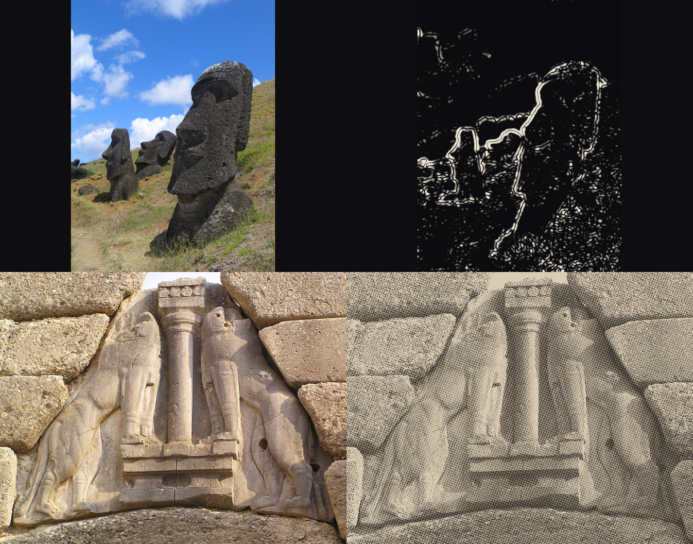

# Step 10 — two treatment tests

Two treatments, one slot each, on real material from run #1. Both are **plate
treatments**: they run on the picture and never on type, so the scene's labels
are drawn over them in the type pass exactly as for an untreated still. A
treatment that baked its own labels would take the film's grain on their edges.



*Top: S 049 / RANO RARAKU, original and sketched reconstruction.
Bottom: S 044 / LION GATE, original and halftone collage.*

## Halftone collage — works, use it

The Lion Gate reads as a plate from a book. That is the register the treatment
was for: a citation beat, where the claim lives in print rather than in stone,
and run #1's answer was a text card that reads as a slide.

The screen is rotated 15°, because an unrotated one beats against the pixel
grid and reads as a digital artefact rather than as print; the stock is warmed
8% towards the palette's ochre and carries a faint fibre.

**Recommendation: adopt**, for citation and record beats. One caveat for a
moving shot — a fixed screen over a moving picture crawls, because the dots
stay put while the image travels under them. On a locked frame it is fine. If
it is ever wanted under a camera move, the screen has to move with the image,
which is not implemented.

## Sketched reconstruction — not yet

It does what it says: the moai outlines are drawn, the sky is clean, the real
geometry is kept, which is the whole argument for deriving a drawing from a
photograph rather than commissioning one.

It still reads as an edge-detect rather than as a drawing. A site drawing has
a hand in it — line weight that follows what the draughtsman thought mattered,
and empty space where they decided nothing did. This has uniform attention: it
draws the grass as carefully as the statue.

**Recommendation: do not adopt as it stands.** It is honest enough for a
background plate and not good enough for a beat that is asking the viewer to
believe a reconstruction.

Three things were measured on the way, and are in the code:

- **A drawing is edges, not tone.** The first version added ink in proportion
  to darkness "so the drawing sits on the rock's form". It did not draw the
  rock, it filled it — the moai came out as white silhouettes, because a dark
  subject is a large dark region.
- **Every parameter is in pixels**, so the same settings at 640 and 1280 are
  two different drawings, not one drawing at two sizes. At 640 the hillside
  was suppressed and at 1280 it was a field of noise. The extraction now runs
  at a fixed working width and the line map is scaled up.
- **The smoothing was chosen by looking**, at four settings side by side.
  Milder and the hillside is noise; stronger and the outlines become blobs.

## Reproducing

```bash
python scripts/treatment_tests.py --project they-said-it-couldnt-be-built
```
