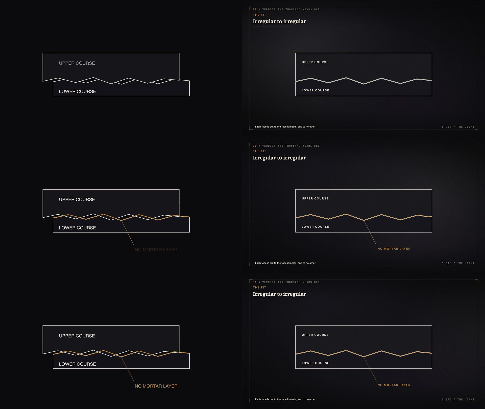

# Step 9 — Manim as the diagram route

The same scene drawn both ways: **S 015 / THE JOINT**, from run #1, 6.6
seconds, four layers and three labels. The Manim version is generated from the
cut's own layer definitions by `scripts/manim_schematic_probe.py`, so both
sides are drawn from one source of truth — a hand-redrawn comparison would be
a judgement about the drawing rather than about the route.



*Left: Manim. Right: the `Schematic` component. Rows at 2.0s, 4.6s and 6.0s.*

## What the comparison shows

**The geometry is a draw.** Both draw the contact line on rather than fading
it in, both hold the same timings, and the shapes are identical because they
come from the same paths. Manim's `Create` and the component's animated
`stroke-dashoffset` produce the same gesture.

**The frame is not.** Manim drew the diagram. The component drew the film: the
act strip, the kicker, the Display title and its rule, the source caption, the
scene index, the bracket corners, the plate behind it and the act's grade over
it. That is not a missing feature of the Manim scene — it is the thing the
`Schematic` component actually is. A diagram is not the unit of composition
here; a scene is.

**Cost, measured on the same clip:** Manim 2.6s wall, the component 10.4s.
Manim is four times faster at rendering a quarter of the frame.

## The decisive objection is architectural, not aesthetic

A Manim diagram arrives as a **video**. To use one it would be composited
inside `SceneShell` like any other clip — and at that point its labels are
pixels in a video file, which means:

- they cannot join the type pass, so the film look's grain lands on their
  edges, which is the defect fixed on 2026-10-21;
- they cannot be locked while the plate moves beneath them, because they are
  part of the plate;
- they cannot be read by the type-lock gate, which finds words and measures
  whether they moved.

Everything built this week to stop text shaking would simply not apply to text
that arrived pre-rendered.

## Recommendation

**Keep the component as the diagram route.** It is slower and it is the only
one of the two that produces a scene rather than a drawing.

**Keep Manim for the case it is actually better at**, which is not this: a
genuinely mathematical animation — a function being transformed, a field being
integrated, a graph being traversed — that the component's path-and-reveal
vocabulary cannot express. Nothing in run #1 needed one. If run #2 does, the
probe script is the starting point, and the diagram should be composited as a
plate-layer asset with its labels re-drawn as type in the scene above it,
never baked into the clip.

## Reproducing this

```bash
python scripts/manim_schematic_probe.py --project <id> --cut c015
npx remotion render src/index.tsx Explainer out/step9/c015_component.mp4 \
    --props=out/step9/c015_props.json --frames=0-197 --gl=angle
```

Manim 0.19.1, installed into the project venv. Note that installing it
downgrades `av` from 17.1.0 to 13.1.0; the full suite passes on the downgrade
(2,291 tests), which is the only reason it was left in place.
